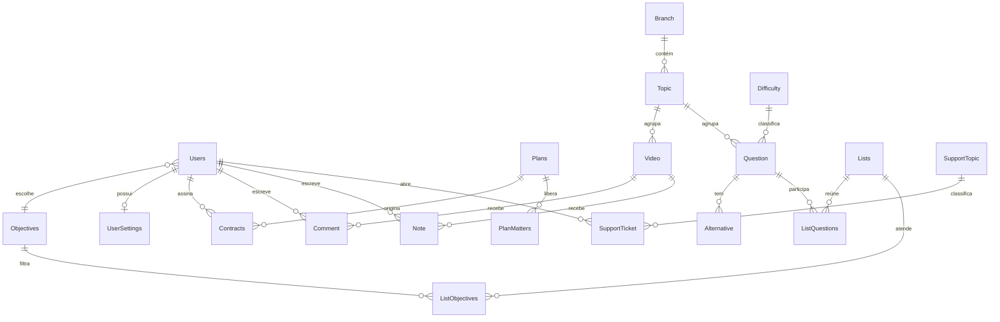

# MyCourse API

API de uma plataforma de cursos online de **Matemática e Física**, com videoaulas, banco de questões, listas de exercícios personalizadas por objetivo (ENEM, ITA, IME...), planos de assinatura por matéria e área de suporte.

Projeto de estudo: estou construindo o back end passo a passo, aprendendo cada decisão de modelagem. O front end foi prototipado no Lovable e servirá de base para os contratos da API.

> **Status:** em desenvolvimento. A modelagem de dados está bem avançada; endpoints, regras de acesso e integração com o front ainda estão em construção.

---

## Tecnologias

- **C# / .NET** (ASP.NET Core Web API, minimal APIs)
- **Entity Framework Core** (code first, migrations e seed com `HasData`)
- **ASP.NET Core Identity** (cadastro, login e papéis)
- **Banco relacional** via provedor do EF Core
- **Front end:** prototipado no Lovable

---

## Funcionalidades planejadas

- Cadastro e login de alunos, com papéis de **Admin** e **Aluno**
- Videoaulas organizadas por **matéria → área → tópico**
- **Comentários** por aula, com marcação do momento do vídeo
- **Anotações** do aluno por vídeo, com cor escolhida
- Banco de **questões** (enunciado em imagem, alternativas com texto e/ou imagem)
- **Listas e pré-listas** de exercícios filtradas pelo **objetivo** do aluno
- **Planos** que liberam apenas matemática, apenas física, ou ambas
- **Contratos (assinaturas)** com início, fim e preço pago
- **Configurações** por aluno (tema, notificações, autoplay, tamanho da fonte, acessibilidade)
- **Suporte** com formulário de tickets por tópico

---

## Modelagem de dados



### Principais entidades

| Entidade | Papel |
|---|---|
| `Users` | Usuário do Identity, com objetivo, escolaridade, data de nascimento, cidade e estado |
| `Objectives` | ENEM, ITA, IME... (tabela, para o admin criar novos) |
| `Branch` / `Topic` | Árvore de conteúdo. Um único par de tabelas para Matemática e Física, diferenciadas pelo enum `Matters` |
| `Video` | Videoaula ligada a um tópico |
| `Comment` | Dúvida da aula, com `VideoTimestampSeconds` opcional |
| `Note` | Anotação do aluno, com cor (`NoteColor`) |
| `Question` / `Alternative` | Questão e alternativas (texto, imagem ou ambos), com a correta marcada em `IsCorrect` |
| `Lists` / `ListQuestions` / `ListObjectives` | Listas com questões ordenadas e filtradas por objetivo (muitos para muitos) |
| `Plans` / `PlanMatters` | Planos e as matérias que cada um libera |
| `Contracts` | Assinatura de um aluno a um plano |
| `UserSettings` | Preferências do aluno (uma linha por usuário) |
| `SupportTopic` / `SupportTicket` | Formulário de suporte e seus tópicos |

---

## Decisões de projeto

Cada decisão abaixo veio de uma dúvida real durante o desenvolvimento.

**Chave estrangeira sempre no lado "muitos".** Vários vídeos pertencem a um tópico, então o `Video` guarda o `TopicId`. O mesmo vale para comentários, alternativas e contratos. Listas de navegação (`List<T>`) são só atalhos no código e não criam colunas.

**Enum ou tabela?** Enum para listas pequenas que quase nunca mudam (escolaridade, cor da nota, tamanho da fonte). Tabela quando o conteúdo cresce ou o admin precisa editar (objetivos, tópicos, dificuldades, tópicos de suporte).

**Unificação de Matemática e Física.** Eu havia criado classes separadas para cada matéria, mas isso obrigaria `Video`, `Question` e `Lists` a terem dois campos de tópico. Com um só `Branch`/`Topic` e o enum `Matters`, tudo aponta para `TopicId` e a matéria se descobre subindo a cadeia `Topic → Branch → Matter`.

**Muitos para muitos com tabelas de ligação.** Questões em listas, listas em objetivos e planos em matérias usam tabelas próprias com chave composta, em vez de arrays dentro das entidades.

**Acesso por plano validado na API.** Esconder um botão no front não protege nada. A API confere se existe um contrato ativo, dentro da validade, cujo plano inclui a matéria do conteúdo pedido. Um aluno que assina matemática e física separadamente simplesmente tem dois contratos.

**O gabarito nunca vai para o front.** A API devolve alternativas sem `IsCorrect` e corrige a resposta no servidor, conferindo ainda que a alternativa enviada pertence à questão.

**Plano é o modelo, contrato é a compra.** O plano guarda a duração; o contrato guarda as datas reais e o `PricePaid`, para que mudanças futuras no plano não alterem o que cada aluno já comprou.

**Dados que merecem cuidado.**
- Tempo do vídeo em **segundos (`int`)**, formatado em `mm:ss` só no front.
- Datas em **UTC**, convertidas para o fuso local no front.
- Telefone no formato **E.164** (`+5585999998888`), usando o campo `PhoneNumber` do Identity.
- Idade **calculada** a partir de `BirthDate`, nunca armazenada.
- Valores monetários com `decimal`.
- Imagens guardadas como **URL**, não dentro do banco.

---

## Estrutura do projeto

```
MyCourse/
├── Models/        # Entidades (Users, Branch, Topic, Video, Comment, ...)
├── Data/          # DBContext, seeds e configuração do EF Core
└── Program.cs     # Identity, DbContext e endpoints
```

---

## Como rodar

Pré-requisitos: [.NET SDK](https://dotnet.microsoft.com/download) e um banco compatível com o EF Core.

```bash
git clone https://github.com/SEU-USUARIO/MyCourse.git
cd MyCourse

# configure a connection string em appsettings.json
dotnet tool update --global dotnet-ef
dotnet ef database update
dotnet run
```

Exemplo de configuração em `appsettings.json`:

```json
{
  "ConnectionStrings": {
    "DefaultConnection": "sua-connection-string-aqui"
  }
}
```

---

## Roadmap

- [x] Definição dos models e relacionamentos
- [x] Configuração do Identity com usuário personalizado
- [x] Seed da árvore de conteúdo (matérias, áreas e tópicos)
- [ ] Migrations de todas as entidades
- [ ] Endpoints de cadastro e login
- [ ] CRUD de vídeos, questões, alternativas e listas (área do admin)
- [ ] Política de acesso por contrato e plano
- [ ] Correção de questões e histórico de respostas
- [ ] Comentários e anotações por vídeo
- [ ] Configurações do aluno
- [ ] Suporte: tickets e central de ajuda
- [ ] Integração com gateway de pagamento (webhooks)
- [ ] Conexão com o front end
- [ ] Testes automatizados

---

## O que estou aprendendo

Modelagem relacional, Entity Framework Core e migrations, ASP.NET Core Identity, autorização baseada em regras de negócio, segurança de API (o que nunca expor ao cliente) e como transformar requisitos de produto em modelos de dados.

---

## Autor

**Gustavo Ramalho de Andrade** · [LinkedIn](https://www.linkedin.com/in/seu-perfil) · [GitHub](https://github.com/SEU-USUARIO)
